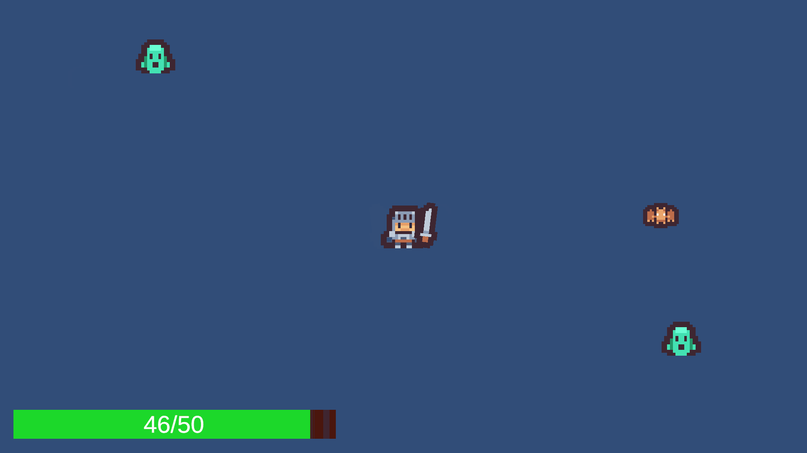

# Survival Roguelite

A *Vampire Survivors*–style survival roguelite built in **Unity 6** (**C#**). Enemies spawn incrementally and swarm the player, who auto-attacks and survives for as long as possible.

---

## Tech Stack

- **Engine:** Unity 6 (Universal 2D / URP)
- **Language:** C#
- **Systems:** Unity Input System, TextMeshPro, Shader Graph
- **Tooling:** Visual Studio, Git

---

## Architecture Notes

### Object pooling
Enemies and slash effects are drawn from a generic object pool instead of being instantiated and destroyed at runtime, which avoids garbage-collection spikes during combat. Each poolable prefab holds a component that records its owning pool when it's taken from that pool, so objects can return themselves without a central manager tracking them.

### Event-driven health and damage
The `Health` component exposes instance events (`OnDied`, `OnHealthChanged`, `OnHit`). The health bar, hit-flash, knockback, and death handling subscribe to these in `OnEnable` and unsubscribe in `OnDisable`, rather than polling health each frame. A new reaction to taking damage is added as a subscriber without touching `Health` itself.

### Facing direction
Player facing is stored in a single `PlayerFlip.Facing` property that the sprite flip, attack placement, and slash orientation all read from. Deriving it from live input instead would return the wrong direction whenever the player attacks while standing still.

### Pooled object reset
Recycled objects reset their own state - velocity, flags, materials, health - in `OnEnable`, and orientation is recomputed from an absolute value each time so a slash reused from the pool doesn't inherit the previous frame's flip.

### Hit-flash
A URP Shader Graph material is swapped onto the sprite renderer on the `OnHit` event and restored afterward.

---

## Systems Implemented

- Generic object pool with self-returning pooled objects
- Three enemy types built off a shared base via Unity's prefab variant system
- Weighted-random enemy spawner
- Health system with clamped damage/heal and instance events
- Contact damage with per-target hit cooldowns and layer-based friendly fire
- Knockback via physics impulse + damping, gated so movement doesn't overwrite it
- URP Shader Graph hit-flash
- Health bar UI with a lagging "ghost" damage indicator
- Object-pooled melee attack with facing-aware placement and orientation

---

## Other Projects

- **[Top-Down Shooter](https://github.com/Lucj0/TopDownShooter)** — earlier Unity project covering similar systems, plus screen shake, audio, and enemies that explode on death.

This project draws on patterns from *Game Programming Patterns* (object pool, observer, singleton, state, component).

---

## About Me

Aspiring gameplay/systems programmer focused on Unity and C#.

- **Email:** [alvinhgwak@gmail.com](mailto:alvinhgwak@gmail.com)
- **LinkedIn:** [alvin-gwak](https://linkedin.com/in/alvin-gwak)